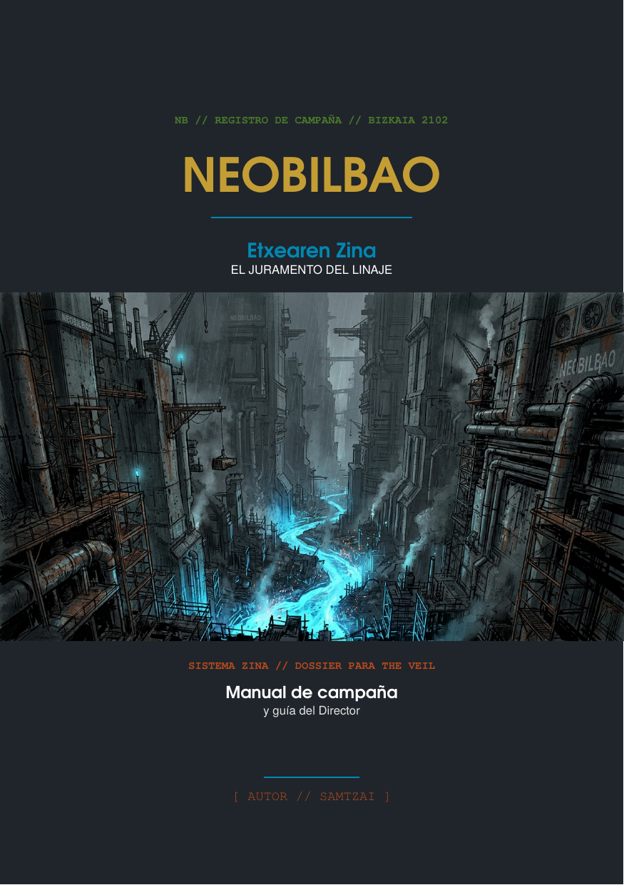
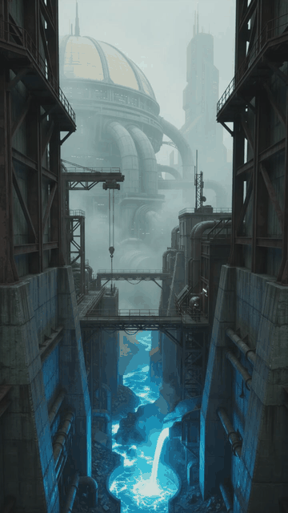
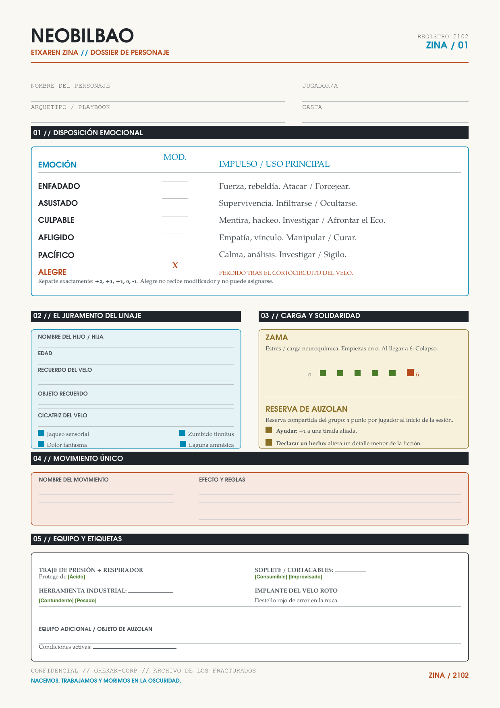

# NEOBILBAO // Etxearen Zina
### *El Juramento del Linaje*

> **Manual de campaña y guía del Director de Juego para ambientación ciberpunk obrera**  
> **Sistema ZINA** (motor narrativo emocional basado en *PbtA* / *The Veil*)  
> **Autor:** Samtzai | **Ambientación:** Exoplaneta Ur-Bare (2102)

---

## ⚡ Acceso Rápido y Recursos de la Campaña

Haz clic en las previsualizaciones para abrir los documentos y el vídeo interactivo en GitHub:

| 📖 Manual de Campaña (PDF) | 🎬 Prólogo Cinemático (Vídeo) | 📋 Ficha de Personaje (PDF) |
| :---: | :---: | :---: |
| [](main.pdf) | [](images/trailer.mp4) | [](ficha_personaje.pdf) |
| [📖 **Abrir Manual Completo (62 págs, A5)**](main.pdf) | [🎬 **Reproducir Vídeo con Audio (.mp4)**](images/NeoBilbao_workers_awakening_in_f%E2%80%A6_20261012215147.mp4) | [📋 **Abrir Ficha de Personaje (A4)**](ficha_personaje.pdf) |

---

## 🎬 Prólogo Audiovisual: *El Despertar*

El inicio de la campaña cuenta con un vídeo introductorio inmersivo con voz en off y ambientación sonora industrial, diseñado para ser reproducido a los jugadores justo antes de iniciar la **Sesión 1**.

[](images/NeoBilbao_workers_awakening_in_f%E2%80%A6_20261012215147.mp4)

* **Formato:** Vídeo cinematográfico vertical (H.264 / AAC)
* **Duración:** 1 minuto 20 segundos
* **Archivo original:** [images/NeoBilbao_workers_awakening_in_f…_20261012215147.mp4](images/NeoBilbao_workers_awakening_in_f%E2%80%A6_20261012215147.mp4)

### Estructura del guion cinematográfico:
1. **Escena 1 — La Ría de Acero (0:00 - 0:20):** Descenso por el cañón industrial de Ur-Bare, los ríos de metal fundido, el colosal puente transbordador y la silueta lejana de la Cúpula Dorada bajo el *sirimiri* ácido.
2. **Escena 2 — El Juramento (0:20 - 0:40):** Los *Langileak* transitando hacia los altos hornos con trajes de presión, escaneados por drones Tártalo y con el implante del Velo palpitando en la nuca.
3. **Escena 3 — El Cordón Umbilical (0:40 - 0:55):** Primer plano del visor de un obrero proyectando la sonrisa de su hijo en el idílico internado superior, administrando su dosis de dopamina sintética.
4. **Escena 4 — El Cortocircuito (0:55 - 1:10):** Una violenta sobrecarga en los generadores de plasma desata un chispazo eléctrico. La transmisión parpadea, llenándose de estática analógica y líneas de error en rojo.
5. **Escena 5 — El Despertar (1:10 - 1:20):** La pantalla se funde a negro. Entre la interferencia resuena un susurro desgarrador: *«Aita... Ama... despertad...»*.

---

## 🌆 La Ambientación: NeoBilbao (Ur-Bare, 2102)

<p align="center">
  
  <br>
  <em>La Ría de Acero y los Zócalos Industriales en el exoplaneta Ur-Bare</em>
</p>

En el año 2052, la expedición de **Euskal-Astra** alcanzó la órbita del exoplaneta **Ur-Bare**, un mundo hostil y desértico barrido por tormentas de polvo rojo y atmósferas corrosivas. En las entrañas tectónicas de la **Ría de Acero** descubrieron el **Burdin-Urdin** (*Acero Azul*), un mineral superconductor exótico e irremplazable para el viaje interestelar.

Lo que comenzó como una colonia comunitaria basada en la solidaridad del **Auzolan** (trabajo vecinal) derivó en una pesadilla corporativa tras la **Guerra del Plasma (2088–2094)**, cuando el megaconsorcio **Orekak-Corp** privatizó el suministro de aire filtrado:

* **Los Zócalos Industriales:** El abismo brutalista inferior donde los obreros (*Langileak*) sobreviven hacinados en turnos de 16 horas, respirando aire tóxico y lluvia ácida sintética.
* **La Cúpula Dorada:** La metrópolis de titanio y curvas de diseño que brilla en lo alto del escudo atmosférico, reservada exclusivamente para la oligarquía (*Zaharrak*) y el Directorio corporativo (*Batzordea*).
* **El Etxearen Zina (*El Juramento del Linaje*):** Tras la Gran Huelga de 2102, la corporación ejecutó la **Cosecha**, secuestrando a todos los niños de la colonia. Los padres fueron obligados a firmar una servidumbre perpetua: trabajar en la fundición a cambio de que sus hijos crecieran en el paraíso de la Cúpula Dorada.
* **El Velo:** El implante neuronal obligatorio que proyecta en los visores de los obreros falsas transmisiones y hologramas felices de sus hijos, anestesiándolos neuroquímicamente para mantenerlos dóciles.

<p align="center">
  
  &nbsp;
  
  <br>
  <em>Izquierda: Los Langileak marchando hacia la fundición. Derecha: La élite bajo la Cúpula Dorada.</em>
</p>

---

## 🎲 Motor de Reglas: ZINA

El **Sistema ZINA** es un motor narrativo ligero adaptado de los principios *Powered by the Apocalypse* (PbtA) y *The Veil*:

### 1. Estadísticas Emocionales
En NeoBilbao no existen atributos físicos convencionales como Fuerza o Destreza. Lo que define la reacción de un personaje ante el horror y la opresión es su estado anímico actual. Los personajes reparten el conjunto **(+2, +1, +1, 0, -1)** entre:
* **Enfadado:** Rebeldía, fuerza bruta, confrontación física y choque directo (*Atacar / Forcejear*).
* **Asustado:** Instinto de supervivencia, huida y esquiva (*Infiltrarse / Ocultarse*).
* **Culpable:** El peso del secreto, la resistencia mental y el pirateo de sistemas (*Investigar / Analizar*).
* **Afligido:** Empatía, conexión humana, consuelo y persuasión (*Manipular / Convencer*).
* **Pacífico:** Calma calculada, análisis sereno, sigilo técnico y sangre fría.

> ⚠️ **La Abstinencia del Etxea:** Al cortocircuitarse el implante del Velo en la primera sesión, la emoción **Alegre** desaparece permanentemente de la hoja del personaje. No hay lugar para la euforia artificial en NeoBilbao.

### 2. Resolución de Acciones (2d6 + Emoción)
* **10+ (Éxito Total):** Consigues tu objetivo limpiamente sin complicaciones.
* **7–9 (Éxito con Coste):** Logras tu objetivo, pero el Director introduce una complicación, gasta etiquetas de equipo o impone desgaste/estrés.
* **6 o menos (Fallo):** Las cosas salen rematadamente mal; el Director ejecuta un movimiento duro.

### 3. Zama (Estrés y Colapso)
Los personajes registran la carga psicológica acumulada en una escala de **0 a 6 de Zama**. Al alcanzar 6 puntos, el personaje sufre un **Colapso** (desmayo, pánico ciego o acatamiento involuntario de las órdenes del sistema). Se descomprime compartiendo momentos de descanso humano en refugios clandestinos.

### 4. Reserva de Auzolan
Un banco grupal de puntos de solidaridad obrera que los jugadores pueden gastar para prestarse apoyo mutuo (+1 a una tirada arriesgada) o declarar recursos y contactos ocultos en la ficción.

---

## 👥 Arquetipos de Personajes

Los jugadores escogen entre cinco arquetipos obreros y marginales, cada uno con su Movimiento Único y su trasfondo dentro del conflicto:

1. **El Fundidor / Siderúrgico:** Especialista en fuerza bruta, resistencia térmica y combate con herramientas pesadas.
2. **El Técnico de Mantenimiento:** Conocedor de los túneles ciegos, conductos de ventilación y cableado antiguo de los Zócalos.
3. **El Delegado / Enlace:** Líder sindical clandestino, pilar moral y voz del Auzolan entre los obreros.
4. **El Técnico Rebotado:** Antiguo burócrata (*Bitartekoa*) de la corporación que descubrió la verdad y desertó a los niveles inferiores.
5. **La Médica del Círculo:** Antigua operativa médica de la División Sorgin, experta en tratar heridas de plasma y el síndrome de abstinencia neuroquímica.

---

## 🗺️ Estructura de la Campaña (5 Actos)

1. **Sesión 1: El Despertar**  
   La rutina en los altos hornos, el cortocircuito del generador de plasma, la pérdida de la señal del Velo y la primera huida del capataz en exoesqueleto Basajaun guiados por la IA *Mari*.
2. **Sesión 2: Fantasmas en la Estática**  
   El síndrome de abstinencia neuroquímica y los mensajes fantasma de la red *Sugaar*. Infiltración para borrar registros biométricos entre la masa de obreros aún anestesiados, esquivando drones Tártalo.
3. **Sesión 3: La Anatomía del Frío**  
   Sabotaje en «La Aguja» (los astilleros verticales de la Ría) y descenso por los canales subacuáticos de refrigeración acechados por las unidades de asalto *Lamia*.
4. **Sesión 4: El Mar de Conciencias**  
   Infiltración en las cámaras criogénicas subterráneas de ADUR-OS. Revelación del destino real de los niños secuestrados: utilizados como procesadores biológicos vivos para alimentar la Cúpula.
5. **Sesión 5: El Pacto del Linaje**  
   Ascenso final a la Cúpula Dorada, confrontación decisiva con la IA *Sugaar* y el Directorio, y el dilema supremo: la desconexión total o la creación de un nuevo orden.

---

## 🛠️ Compilación y Desarrollo de los Documentos

El manual completo y la ficha de personaje están maquetados en **XeLaTeX** con una tipografía industrial personalizada, paleta de colores corporativos y maquetación editorial.

### Requisitos previos:
```bash
sudo apt-get update
sudo apt-get install -y texlive-xetex texlive-latex-extra texlive-fonts-recommended texlive-lang-spanish latexmk
```

### Compilar los PDFs:
```bash
make
```
El `Makefile` compila en dos pasadas consecutivas para generar:
* `main.pdf` — Manual de campaña y guía del Director (62 páginas, tamaño A5).
* `ficha_personaje.pdf` — Ficha de personaje ZINA para los jugadores (1 página, tamaño A4).

### Limpiar archivos temporales:
```bash
make clean
```

---

## 📁 Estructura del Repositorio

```text
neobilbao/
├── main.pdf                                          # Manual completo compilado (A5)
├── ficha_personaje.pdf                               # Ficha de personaje para impresión (A4)
├── main.tex                                          # Archivo maestro LaTeX del libro
├── ficha_personaje.tex                               # Código fuente LaTeX de la ficha
├── neobilbao.sty                                     # Hoja de estilos, paleta de colores y macros
├── Makefile                                          # Automatización de compilación con XeLaTeX
├── video_prompt.txt                                  # Guion cinemático detallado para el tráiler
│
├── chapters/                                         # Capítulos del manual
│   ├── 00_portada.tex                                # Portada institucional
│   ├── 01_introduccion.tex                           # Introducción y prólogo audiovisual
│   ├── 02_secreto_director.tex                       # Revelaciones para el Director de Juego
│   ├── 03_historia.tex                               # Cronología y trasfondo de Ur-Bare
│   ├── 04_castas_facciones.tex                       # Castas sociales y corporaciones
│   ├── 05_conflicto_ias.tex                          # Guerra silenciosa entre Mari y Sugaar
│   ├── 06_seguridad.tex                              # Tropas Basajaun, Lamiak y drones Tártalo
│   ├── 07_motor_zina.tex                             # Reglas del sistema emocional ZINA
│   ├── 08_arquetipos.tex                             # Creación de personajes y arquetipos
│   ├── 09_guia_director.tex                          # Consejos de dirección y movimientos del MC
│   └── 10_campana_5_actos.tex                        # Desarrollo paso a paso de los 5 actos
│
└── images/                                           # Ilustraciones y recursos multimedia
    ├── cover_preview.png                             # Vista previa de la portada para GitHub
    ├── ficha_preview.png                             # Vista previa de la ficha para GitHub
    ├── trailer_preview.gif                           # Autopreview animado del tráiler
    ├── trailer_poster.png                            # Fotograma póster en alta resolución
    ├── NeoBilbao_workers_awakening_in_f…_20261012215147.mp4  # Vídeo cinemático original con audio
    ├── sessions/                                     # Ilustraciones de los actos de campaña
    └── *.jpg                                         # Arte conceptual de la ambientación
```

---

## ✒️ Créditos y Licencia

* **Diseño y autoría:** Samtzai
* **Universo:** *NeoBilbao // Ur-Bare 2102*
* **Ilustraciones y cinemática:** Generadas específicamente para el proyecto NeoBilbao
